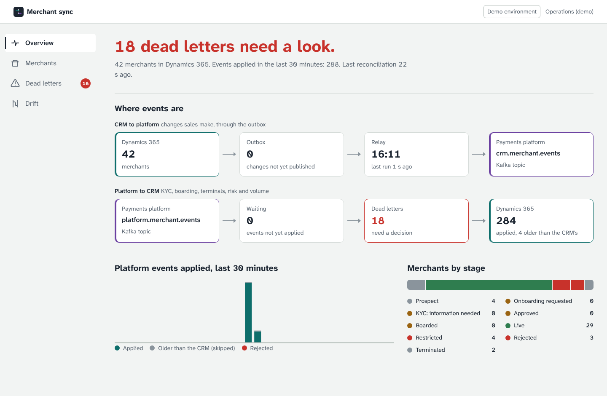
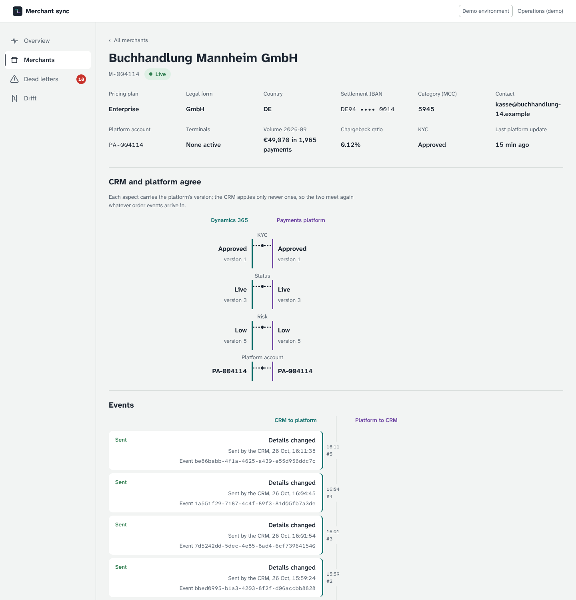
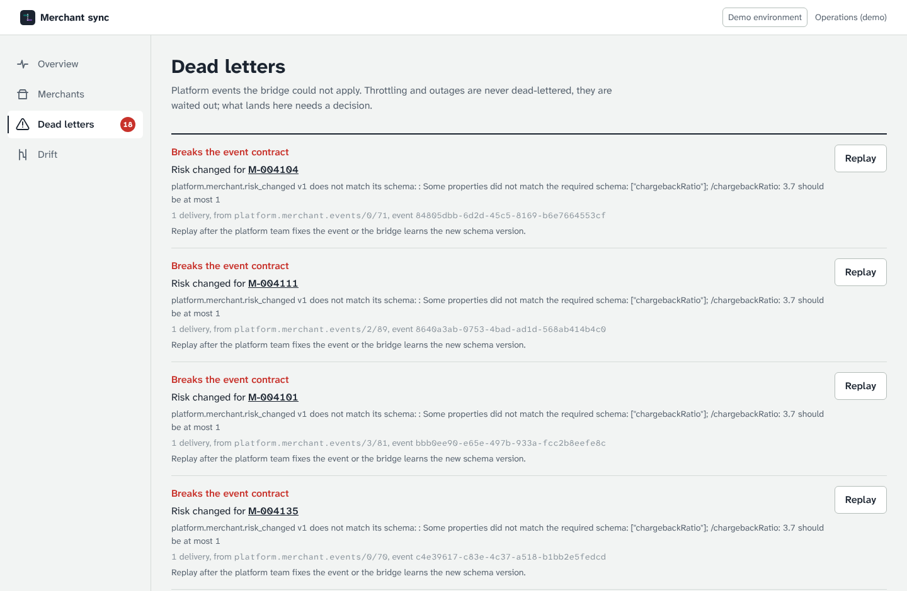
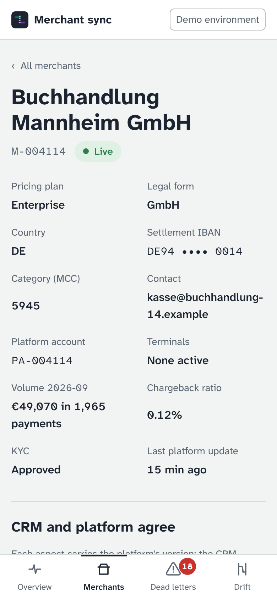
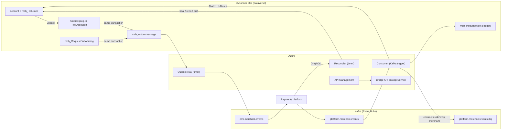

# merchant-crm-bridge

Keeps **Microsoft Dynamics 365 (Dataverse)** and a **payments platform** in step over **Apache Kafka**, for the
whole life of a merchant: sales hands a won merchant over in the CRM, the platform runs KYC, boards it,
activates terminals, rates its risk and reports its volume, and every one of those facts lands back on the
account in Dynamics 365. It does this correctly when events arrive twice, out of order or not at all, when
Dataverse throttles, when consumers crash halfway through a write, and when somebody edits a field they
should not have.

[](https://github.com/manojrevenkar12-web/merchant-crm-bridge/actions/workflows/ci.yml)



| A merchant, CRM and platform stitched together | Dead letters, replayed once | On a phone |
| --- | --- | --- |
|  |  |  |

## What is in here

| Part | What it is | Where |
| --- | --- | --- |
| Dataverse model | Account columns, five tables, nine choices, alternate keys, column security, two security roles, environment variables, connection references, a model-driven app, a cloud flow. One file. | [`dataverse/model.json`](dataverse/model.json) |
| Plug-ins | Validation (IBAN mod-97, MCC, country, merchant id) in PreValidation; the **transactional outbox** in PreOperation, so a change and its event commit together; echo suppression for the bridge's own user. Strong-named .NET Framework 4.6.2 adapters over rules that are tested on .NET 10. | [`src/Bridge.Plugins`](src/Bridge.Plugins), [`src/Bridge.Plugins.Logic`](src/Bridge.Plugins.Logic) |
| Custom API | `mcb_RequestOnboarding`, bound to account: checks completeness, moves the stage, writes the event, in one transaction. | same |
| PCF control | `MerchantSyncStatus` for the account form: the onboarding path and what happens next. | [`pcf/MerchantSyncStatus`](pcf/MerchantSyncStatus) |
| Event contracts | CloudEvents 1.0, JSON Schema per type and version, an upcaster for the old `volume_reported` v1. | [`contracts/`](contracts) |
| Consumer | Platform events into Dataverse: ledger dedupe, versioned aspects, one `$batch` changeset with `If-Match`, rewind and wait on 429/5xx, dead letters only for what cannot be applied. | [`src/Bridge.Core`](src/Bridge.Core) |
| Outbox relay | Publishes the Dataverse outbox to Kafka in commit order per merchant, under a lease, with an idempotent producer. | same |
| Reconciler | Reads the platform's GraphQL view; heals what lost events missed, reports what people changed. | same |
| Dataverse client | Web API with OData paging, alternate keys, conditional writes, `$batch` changesets, Retry-After, managed identity or client credentials. | [`src/Bridge.Dataverse`](src/Bridge.Dataverse) |
| Function App | Kafka trigger with an unbounded exponential retry policy, timers for relay and reconciler. | [`src/Bridge.Functions`](src/Bridge.Functions) |
| API | REST (OpenAPI 3.1) and GraphQL for operations, Entra app roles `Sync.Read` / `Sync.Operate`. | [`src/Bridge.Api`](src/Bridge.Api), [`contracts/openapi.json`](contracts/openapi.json) |
| Operations console | React + TypeScript + Framer Motion. Where events are, each merchant side by side, dead letters, drift. | [`web/`](web) |
| ALM | Schema as code through the Web API, a reviewed plan, deployment settings per environment, export managed, import downstream. | [`src/Bridge.Alm`](src/Bridge.Alm), [`alm/`](alm), [`.github/workflows/alm.yml`](.github/workflows/alm.yml) |
| Azure | Bicep: App Service, Function App, API Management, Event Hubs (Kafka), Key Vault, managed identity, Application Insights, alerts. | [`infra/`](infra) |
| Emulator and simulator | A Dataverse Web API emulator (with the real plug-in rules, column security, service protection) and a payments platform that misbehaves on purpose. | [`src/Bridge.Emulator`](src/Bridge.Emulator), [`src/Bridge.PlatformSim`](src/Bridge.PlatformSim) |
| Drills | Whole-system runs under chaos, crashes, contention and throttling, with checks that must pass. | [`src/Bridge.Drills`](src/Bridge.Drills), [`reports/DRILLS.md`](reports/DRILLS.md) |

## How it fits together



## What it guarantees, and where that is checked

| Guarantee | How | Checked by |
| --- | --- | --- |
| A CRM change and its event commit together or not at all | The outbox row is written by a PreOperation plug-in inside the update's transaction | `DataverseClientTests` (outbox rows in the same transaction), drills |
| Any order and any duplication of platform events gives the same CRM state | Each aspect (KYC, status, risk, volume) carries the platform's version; older ones are recorded as stale, never applied; the stage is derived from the aspects | 500-run property test in `MapperTests`; every drill's *Events alone converge* check |
| Each event changes the CRM at most once | Ledger row with alternate key `mcb_eventid`, written in the same `$batch` changeset as the account (`If-None-Match: *`) | `ServiceTests`, *Each event recorded once* |
| Concurrent writers do not lose updates | `If-Match` on the account's ETag; 412 means re-read and decide again | `ServiceTests`, `GatewayTests`, *crashes-and-contention* |
| Throttling never reorders a merchant's events | 429 and 5xx rewind the partition and wait for Retry-After; they are never dead-lettered | *throttling* drill (118 throttled responses, no dead letters); `TriggerDeliveryTests` for the Function App |
| Only what cannot be applied is dead-lettered | Contract violations at once; unknown merchants after 3 deliveries; anything else after 8 | *Dead letters are exactly the broken messages* |
| A dead letter is replayed at most once, by someone allowed to | `POST /v1/dead-letters/{p}/{o}/replay` needs `Sync.Operate`, answers 409 the second time | `DeadLetterTests` (API), console tests |
| Lost events are healed, hand edits are not overwritten | The reconciler applies the platform's snapshot through the same applier when it has a newer version; equal versions with different values become a drift finding | *platform-chaos* (7 healed); `ServiceTests` |
| The bridge never echoes its own writes | The outbox plug-in skips the integration user | *No echo of the bridge's own writes* |
| Platform-owned columns are written only by the bridge | Column security in Dataverse (and the emulator); the plan secures exactly the platform-owned account columns | `AlmTests`, `DataverseClientTests` |
| The sequence cannot be moved by a caller | The plug-in takes the version from the stored row, not the request | `PluginRulesTests` |
| The API does what its contract says | Every mapped endpoint is in `openapi.json` and every response validates against its schema | `ContractTests` (API) |

## The drills

`dotnet run --project src/Bridge.Drills` runs four whole-system scenarios: the API's services against the
Dataverse emulator and the platform simulator, on the in-memory log or on a real broker (`--kafka host:port`,
which CI runs). The checks compare the CRM with the platform's own records after the run.

| Drill | What goes wrong | Result |
| --- | --- | --- |
| steady | nothing | 40 merchants, 299 events, all checks pass |
| platform-chaos | 15 % duplicated, 15 % reordered, 3 % lost, 30 % in the old schema, broken messages | 60 duplicates and 44 reorderings absorbed, 8 lost events explained and 7 merchants healed by the reconciler, 2 broken messages dead-lettered and nothing else |
| crashes-and-contention | consumers crash between the CRM write and the offset commit, three consumers rebalance, people edit the same rows, `$batch` fails with 503 | 27 crashes, 6 concurrency retries, every event recorded once |
| throttling | service protection at 150 requests per 3 s | 118 throttled responses waited out, no dead letters |

Full results: [`reports/DRILLS.md`](reports/DRILLS.md).

## Run it

You need the .NET 10 SDK and Node 22. No Dynamics 365 tenant, Kafka or Docker is needed for the demo.

```bash
# The whole system in one process: emulated Dynamics 365, simulated platform, a sales team, the bridge.
dotnet run --project src/Bridge.Api            # http://localhost:5080 (demo mode in Development)
cd web && npm install && npm run dev           # http://localhost:5173, the operations console

# The same on Apache Kafka, in containers
docker compose up --build                      # http://localhost:8080

# Tests and drills
./scripts/check.sh                             # build, .NET tests, API contract, console checks
dotnet run --project src/Bridge.Drills -- --quick
cd web && npx playwright test                  # against the running demo API

# Dataverse schema: what would change, and the deployment settings
dotnet run --project src/Bridge.Alm -- plan
dotnet run --project src/Bridge.Alm -- settings --check alm/settings
```

Against a real environment the API takes `Bridge:Dataverse:EnvironmentUrl`, a managed identity (or an app
registration with its secret in Key Vault), Kafka settings and `Bridge:Auth` for Entra; see
[`src/Bridge.Api/appsettings.json`](src/Bridge.Api/appsettings.json) and [`infra/main.bicep`](infra/main.bicep).

## Deploying

1. `az deployment group create -g <rg> -f infra/main.bicep -p infra/test.bicepparam` creates the Azure side and
   prints the managed identity's client id.
2. In Dataverse, create an application user for that client id. The `alm` workflow applies the schema to the
   development environment, exports the solution managed and unmanaged, imports the managed one into test with
   [`alm/settings/test.json`](alm/settings/test.json) and gives the application user the *Merchant Bridge
   Integration* role.
3. Publish `src/Bridge.Functions` to the Function App and the API image (or published output) to App Service.

## Honest limits

- Nothing here has run against a real Dynamics 365 tenant. The emulator implements the parts of the Web API
  the bridge uses, with the error codes Dataverse documents, and the plug-in rules are the same code; the
  ALM workflow's apply/export/import runs only when environments are configured.
- The platform is simulated. Its events and GraphQL view are this repository's contracts, written to look
  like a payments platform's, not any company's real API.
- The Function App, plug-in assembly, PCF solution and Bicep build in CI only (they need packages and tools
  this repository's development container could not download).

## Repository map

```
dataverse/        model.json (the schema), flows/
contracts/        event schemas and examples, openapi.json
src/              Bridge.Core (sync logic), .Dataverse, .Kafka, .Platform, .Hosting, .Api, .Functions,
                  .Plugins(.Logic), .Alm, .Emulator, .PlatformSim, .Drills
web/              operations console        pcf/       PCF control
tests/            .NET tests                infra/     Bicep
alm/              metadata plan, deployment settings
docs/             decisions (adr/), research, runbook, screenshots
```

Decisions are written down in [`docs/adr`](docs/adr); the research behind the design is in
[`docs/RESEARCH.md`](docs/RESEARCH.md); what to do when an alert fires is in [`docs/RUNBOOK.md`](docs/RUNBOOK.md).
